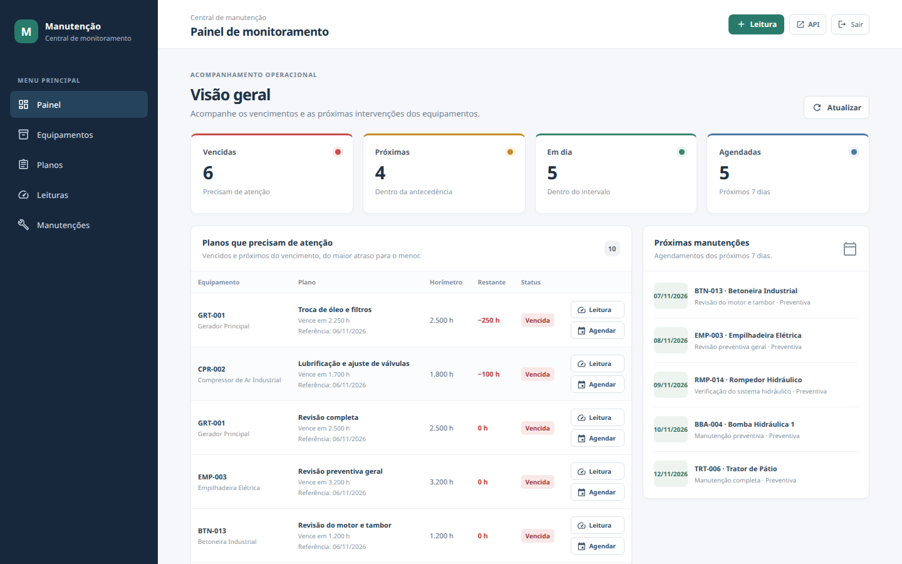
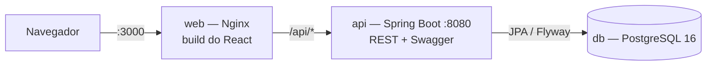
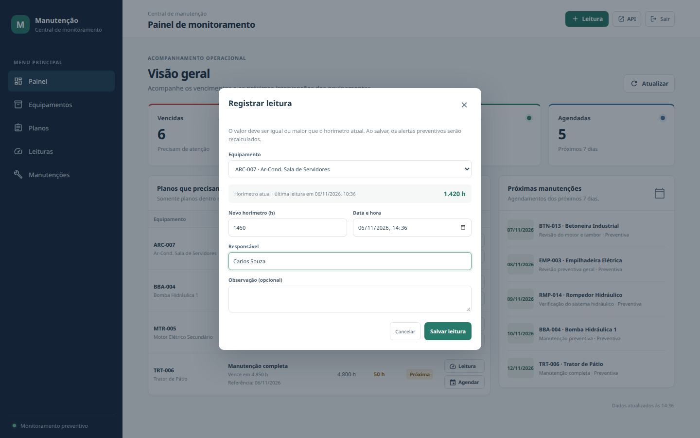
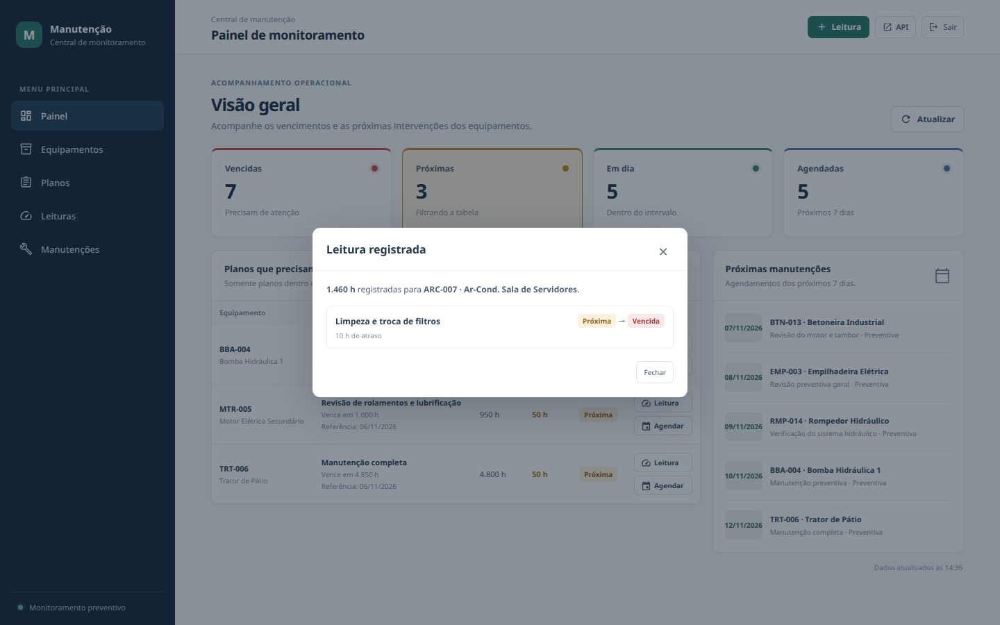
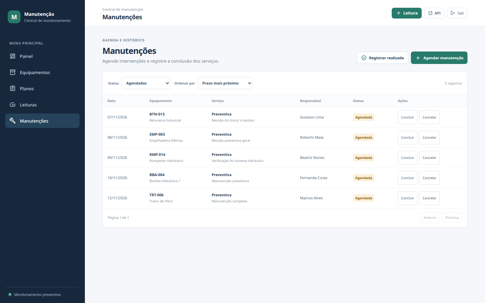
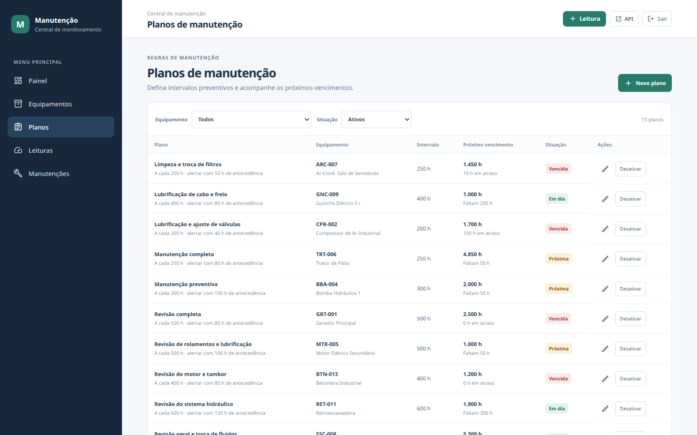
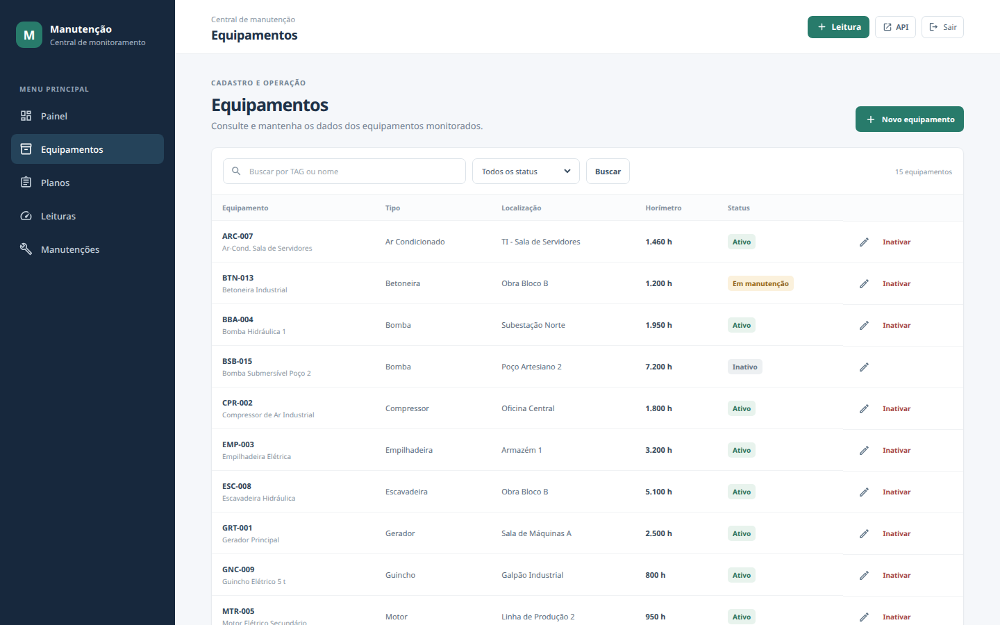
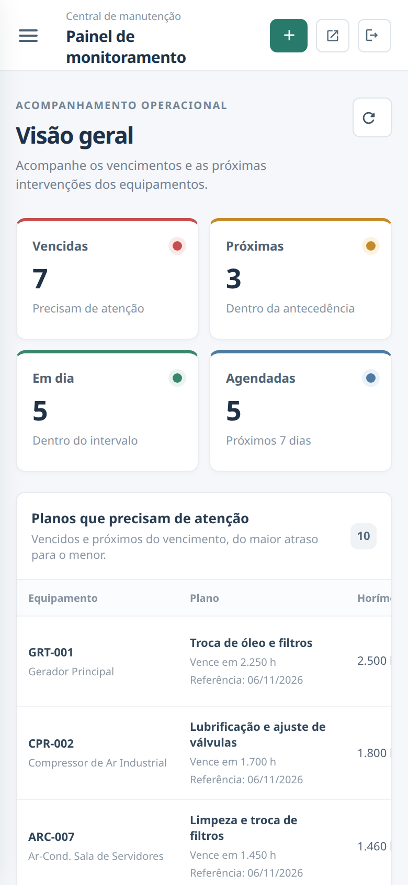

# Central de Monitoramento de Manutenção Preventiva

Aplicação web para acompanhar manutenção preventiva de equipamentos com base no horímetro. O sistema registra equipamentos, planos, leituras e manutenções; calcula alertas de vencimento e exibe um painel operacional.



## Tecnologias

- **Backend:** Java 21, Spring Boot 4, Spring Security, Spring Data JPA, Flyway e Springdoc OpenAPI.
- **Frontend:** React, TypeScript, Vite, React Router e TanStack Query; ícones do Material UI e CSS próprio. Vitest e Testing Library nos testes.
- **Banco:** PostgreSQL 16.
- **Execução local:** Docker Compose e Nginx como proxy de `/api` para o backend.

## Arquitetura



- **Status calculado, não armazenado:** o status de cada plano (vencida, próxima ou em dia) é calculado a cada consulta a partir do horímetro atual, do horímetro da última execução e do intervalo. Assim ele nunca fica desatualizado em relação às leituras.
- **Regras protegidas em duas camadas:** as regras ficam nos services. O banco reforça as críticas com `CHECK`, chaves únicas e um índice único parcial, que garante no máximo um agendamento aberto por plano.
- **Concorrência e contrato:** o equipamento tem lock otimista (`@Version`). Se duas gravações concorrentes atingirem o mesmo registro, a segunda recebe 409 em vez de sobrescrever a primeira. Os erros seguem o ProblemDetail (RFC 7807), e o frontend mostra a mensagem do backend.
- **Tipos derivados do contrato:** os tipos TypeScript do frontend são gerados do OpenAPI do backend.

## Executar com Docker

Pré-requisito: Docker com o plugin Compose.

```bash
docker compose up --build -d
```

Abra:

- Frontend: <http://localhost:3000>
- Swagger UI: <http://localhost:8080/swagger-ui.html>
- Healthcheck: <http://localhost:8080/actuator/health>

**Login de demonstração:** usuário `operador`; a senha é o valor padrão de `APP_AUTH_PASSWORD` em [`docker-compose.yml`](docker-compose.yml). Para alterá-las, defina `APP_AUTH_USERNAME` e `APP_AUTH_PASSWORD` no ambiente ou no arquivo `.env` antes de iniciar os serviços. Não use os valores de demonstração fora do ambiente local. O login do frontend usa HTTP Basic; a página solicita autenticação novamente após recarregar.

As variáveis opcionais estão em [`.env.example`](.env.example). Copie para `.env` se quiser mudar credenciais, a porta do banco ou o fuso.

**Portas usadas:** 3000 (frontend), 8080 (API) e 5432 (PostgreSQL, publicada só em `127.0.0.1`). Se a 5432 já estiver ocupada por um PostgreSQL local, defina `DB_PORT=5433` no `.env`; os containers continuam se falando pela rede interna.

Para acompanhar os serviços:

```bash
docker compose ps
docker compose logs -f api
```

Para parar sem apagar os dados do banco:

```bash
docker compose down
```

O volume `pgdata` guarda os dados do PostgreSQL. `docker compose down -v` também apaga esse volume.

### Dados de demonstração

Na primeira inicialização, o Flyway aplica `V2__seed_demo.sql`, que cria 15 equipamentos com planos **vencidos**, **próximos** e **em dia**, histórico de leituras e manutenções concluídas, canceladas e agendadas. As datas são relativas ao dia em que o seed roda, então o painel sempre mostra agendamentos para os próximos dias. Para recomeçar do zero:

```bash
docker compose down -v && docker compose up --build -d
```

## Executar sem Docker

É necessário JDK 21, Node.js 20+ e um PostgreSQL 16 (pode ser só o do Compose: `docker compose up -d db`).

Configure `DB_URL`, `DB_USER`, `DB_PASSWORD`, `APP_AUTH_USERNAME` e `APP_AUTH_PASSWORD` no ambiente do backend. As migrations Flyway são executadas na inicialização.

```bash
cd backend
./mvnw spring-boot:run
```

Em outro terminal:

```bash
cd frontend
npm ci
npm run dev
```

Acesse <http://localhost:5173>. O Vite já repassa `/api` para `http://localhost:8080` (ver `frontend/vite.config.ts`); no Docker esse papel é do Nginx. Por isso o frontend nunca precisa de CORS nem de URL da API embutida.

## Funcionalidades

- Cadastro, edição, busca, filtros e inativação lógica de equipamentos.
- Planos preventivos associados a equipamentos, com intervalo e antecedência de alerta.
- Registro e histórico de leituras de horímetro.
- Cálculo de planos vencidos, próximos do vencimento e em dia.
- Agendamento, conclusão e cancelamento de manutenções, e registro direto de uma manutenção já realizada (corretiva ou preventiva), sem agendamento prévio.
- Painel com indicadores (os cards de vencidas e próximas filtram a tabela), alertas com ações de registrar leitura e agendar, e próximas manutenções.
- Ao registrar uma leitura, o sistema mostra quais planos mudaram de situação (ex.: Próxima → Vencida).
- Lista de manutenções com escolha de ordem (padrão: prazo mais próximo).
- Autenticação HTTP Basic para as rotas de negócio.

## Telas

| Registrar leitura a partir de um alerta | Impacto da leitura nos planos |
|---|---|
|  |  |

| Manutenções (ordenadas pelo prazo) | Planos de manutenção |
|---|---|
|  |  |

| Equipamentos | Painel no celular |
|---|---|
|  |  |

## Regras principais

- **Próximo vencimento:** horímetro da última execução + intervalo do plano.
- **Vencida:** horímetro atual igual ou maior que o próximo vencimento.
- **Próxima:** ainda não venceu e faltam horas menores ou iguais à antecedência configurada.
- Uma leitura não pode ter valor menor que o horímetro atual nem data anterior à leitura mais recente.
- A edição da configuração de um plano não altera seu horímetro de última execução. Esse valor é atualizado ao concluir uma manutenção preventiva.
- Não é possível agendar para uma data passada. O "hoje" segue o fuso `APP_TIMEZONE` (padrão `America/Sao_Paulo`), porque o servidor roda em UTC.
- Uma preventiva exige plano ativo; o banco também impede agendamentos duplicados para o mesmo plano.
- Inativar equipamento preserva o histórico.

## Testes

O backend possui 25 testes. Os unitários cobrem o cálculo de status nos limites (em dia, próxima, vencida) e o ciclo do plano. Os de integração, com PostgreSQL 16 via Testcontainers, cobrem:
- leituras regressivas, retroativas, futuras ou em equipamento inativo;
- conclusão preventiva recalculando o vencimento;
- agendamento duplicado, para plano inativo ou com data no passado;
- o contrato HTTP de erros (400 com campos inválidos ou ordenação inválida, 409 e 401) e a ordenação da lista de manutenções;
- o contrato OpenAPI do qual o frontend gera seus tipos.

Docker precisa estar disponível para a suíte de integração.

```bash
cd backend
./mvnw test
```

O frontend usa Vitest e Testing Library (10 testes): formatadores, o selo de status e o cálculo do impacto de uma leitura nos planos.

```bash
cd frontend
npm ci
npm test
npm run build
```

O código do frontend é formatado com Prettier (`npm run format`).

### Tipos da API no frontend

Os tipos TypeScript das respostas vêm do OpenAPI do backend, em `frontend/src/api/schema.d.ts`, com apelidos em `frontend/src/api/tipos.ts`. O arquivo gerado é versionado, então o frontend compila sem a API no ar. Depois de mudar um DTO no backend, com a API rodando:

```bash
cd frontend
npm run gen:api
```

Se o frontend usar um campo que mudou, o `tsc` aponta o erro.

## Organização

O backend é organizado por funcionalidade (`equipamento`, `plano`, `leitura`, `manutencao`, `alerta`, `dashboard`, `seguranca` e `shared`). Entidades concentram operações de domínio; Services aplicam regras transacionais; Controllers expõem DTOs REST. O schema é versionado em `backend/src/main/resources/db/migration`.

Erros seguem o padrão `ProblemDetail` (RFC 7807), centralizado em `shared/GlobalExceptionHandler`: 400 para validação (com o campo `errors` indicando cada campo inválido), 404 para recurso inexistente, 409 para conflitos (código duplicado, agendamento duplicado, edição concorrente) e 422 para regra de negócio violada. Detalhes internos, como o SQL de uma constraint, ficam só no log.

O frontend separa as páginas por funcionalidade em `frontend/src/features` (o painel fica em `features/dashboard`) e os componentes e formatadores reutilizados em `frontend/src/shared`; `frontend/src/api/http.ts` centraliza chamadas REST e autenticação.

Mais contexto e decisões estão em [`docs/contexto-para-llm.md`](docs/contexto-para-llm.md), no [modelo de dados](docs/modelo-de-dados.md) e nas [telas](docs/telas.md).

## Segurança e escopo

A autenticação atual usa um único usuário em memória, configurável por ambiente. É adequada à demonstração local do desafio, sem cadastro de usuários ou autorização por papéis. HTTP Basic não criptografa o transporte: qualquer implantação externa deve usar HTTPS e credenciais próprias. O healthcheck e os recursos do Swagger ficam públicos; chamadas aos endpoints de negócio exigem autenticação. A senha é guardada com hash (BCrypt) e o frontend mantém as credenciais só em memória. O PostgreSQL é publicado apenas em `127.0.0.1`, e o Nginx envia cabeçalhos básicos de segurança (`X-Content-Type-Options`, `X-Frame-Options` e `Referrer-Policy`).

## Próximas melhorias

- Persistência e administração de usuários, autorização por papéis e HTTPS em implantação.
- Página de detalhe do equipamento (histórico de leituras, planos e manutenções em um só lugar).
- Testes de componente cobrindo os fluxos de tela (cadastro, leitura, agendamento).
- Separar o CSS do painel do CSS do layout geral (`App.css`).
- Enviar a `version` do equipamento na edição, para detectar também alterações feitas por outra pessoa enquanto o formulário estava aberto.
