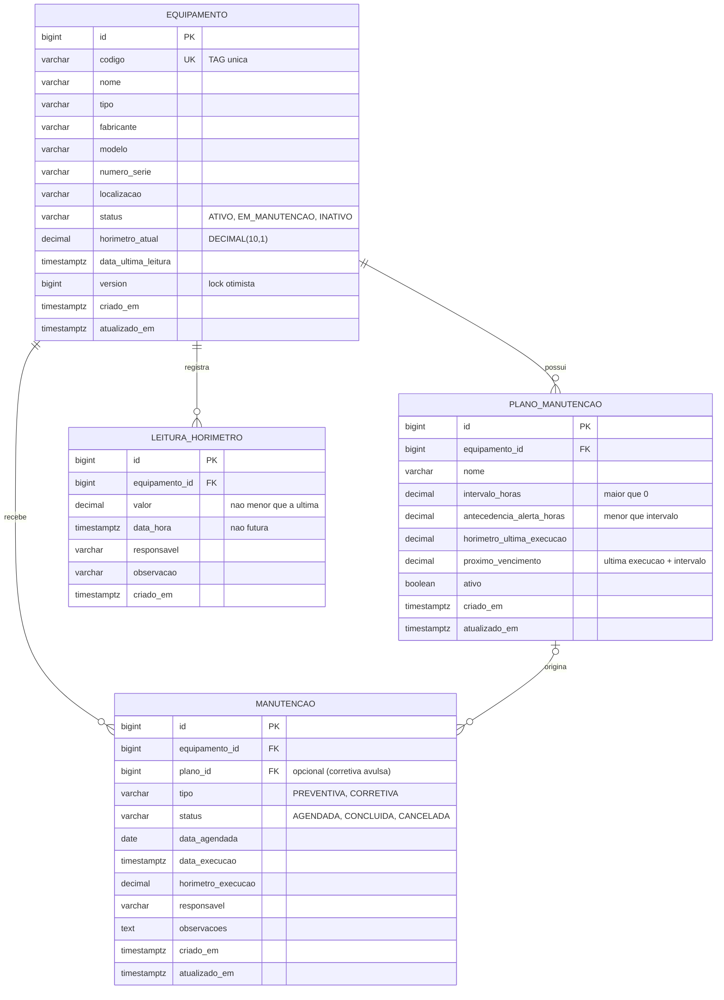

# Modelo de dados

Banco: PostgreSQL, versionado com Flyway (`backend/src/main/resources/db/migration`).

## Diagrama ER



## Dicionário e decisões

| Item | Decisão |
|---|---|
| Chaves | `BIGINT GENERATED ALWAYS AS IDENTITY` |
| Enums | `VARCHAR` com `CHECK`, mapeados com `@Enumerated(EnumType.STRING)` |
| Horas | `DECIMAL(10,1)`, `BigDecimal` no Java |
| Datas | `TIMESTAMPTZ`, `OffsetDateTime`/`Instant` no Java |
| Exclusão | Sem delete físico: equipamento vira `INATIVO` |
| Alertas | Sem tabela. Derivados de `horimetro_atual` x `proximo_vencimento` |
| `proximo_vencimento` | Persistido. Recalculado ao criar/editar o plano e ao concluir uma manutenção ligada a ele |
| `horimetro_atual` | Atualizado na mesma transação da leitura; `@Version` evita conflito de escrita |

## Fórmula de status do plano

```
restante = proximo_vencimento - horimetro_atual

restante <= 0                    -> VENCIDA
restante <= antecedencia_alerta  -> PROXIMA
caso contrário                   -> EM_DIA
```

## Constraints (CHECK)

- `equipamento.horimetro_atual >= 0`
- `plano_manutencao.intervalo_horas > 0`
- `plano_manutencao.antecedencia_alerta_horas >= 0 AND < intervalo_horas`
- `leitura_horimetro.valor >= 0`
- `manutencao.status = 'CONCLUIDA'` exige `data_execucao` e `horimetro_execucao` preenchidos

## Índices

| Índice | Finalidade |
|---|---|
| `UNIQUE equipamento(codigo)` | TAG única |
| `leitura_horimetro(equipamento_id, data_hora DESC)` | Última leitura e histórico |
| `plano_manutencao(equipamento_id, ativo)` | Planos ativos por equipamento |
| `plano_manutencao(proximo_vencimento)` | Consulta do painel de alertas |
| `manutencao(status, data_agendada)` | Próximas agendadas |
| `UNIQUE manutencao(plano_id) WHERE status = 'AGENDADA'` | Índice parcial: impede dois agendamentos abertos para o mesmo plano |

## Regras que o banco não cobre (ficam no Service)

- Leitura não pode ser menor que a última nem de equipamento inativo (precisa consultar estado atual).
- Agendamento só para plano ativo.
- Horímetro da última execução do plano não pode ser maior que o horímetro atual do equipamento.
